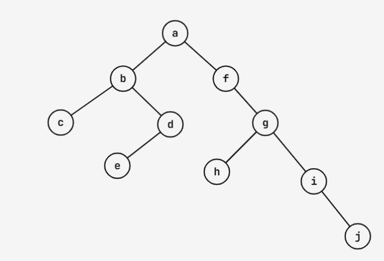

## 二叉树的存储
- 顺序存储
完全二叉树：正常从 1 开始编号
非完全二叉树：以完全二叉树为基准来编号，缺点：有浪费的空间
- 链式存储


```c
typedef struct BiTNode{
    TElemType data;
    struct BiTNode* lchild, *rchild;
} BiTNode, *BiTree;
```

> 二叉链表存储结构二叉树上有 n 个结点，有多少个空指针？
 $n + 1$

## 遍历

### 先序遍历
根左右

### 中序遍历

左根右

不可能知道谁是根

### 后序遍历

左右根


```c
void Preorder(BiTree T){
    if(T){
        printf("%c", T->data);
        Preorder(T->lchild);
        preorder(T->rchild);
    }
}
```

> 算法分析
eg: 先序遍历输出满足...条件的结点的...


## 练习题
中序遍历 cbedafhgij，后序遍历cedbhjigfa，画出二叉树
后序遍历确定根，中序遍历区分在左子树和右子树，两步交错进行
